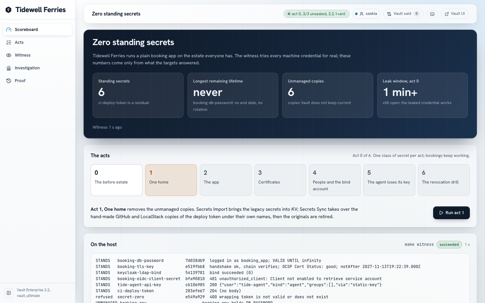

# vault_ultimate: Zero Standing Secrets

A fictional ferry company runs a real, plain booking app on the estate most
companies have: a database password in a file, an LDAP bind password nobody
rotates, a year-long certificate, a deploy token pasted into CI, an AI agent
with a static key. A witness tries every one of those credentials for real
and a scoreboard counts what still works. Six acts on Vault Enterprise 2.2
migrate the same running app, one class of secret per act, while bookings
keep working, until only one counted residual stands and everything else
lives for minutes.

> **Terraform builds the house. Ansible decorates it. Vault keeps the keys.
> Make is the front door.**



## What it proves, and what it only illustrates

**Proves**, each claim measured by `make rehearsal` and `make test-ui`:

- A running app loses its static database password, its year-long
  certificate, its Keycloak client secret, the LDAP bind password behind its
  sign-in and its agent's static key, and bookings keep working.
- The witness tries each credential against its target (a PostgreSQL login,
  an LDAP bind, a Keycloak client grant, the booking API, a TLS handshake
  with an OCSP request to Vault) and keeps the answer verbatim. Before:
  `VALID UNTIL infinity`. After: `password authentication failed`,
  `OCSP Cert Status: revoked`, `Invalid credentials (49)`, `invalid_client`.
- What replaced them lives minutes: a 15-minute database lease, a one-hour
  certificate, a 300-second delegation token.
- One revocation by a named person ends the leased credential's open
  PostgreSQL session in under a second; one rotation reaches GitHub and
  LocalStack, by their own clocks.
- An AI agent acting for a clerk rebooks a cancelled crossing with the
  clerk's delegated authority, and Vault, not the app, refuses its
  overreach: `CEILING_POLICY_DENIED`.

**Illustrates only:** Tidewell Ferries, its people and every value are
invented; LocalStack stands in for AWS Secrets Manager; Ansible stands in
for a platform that vouches for workloads; one presenter drives everything;
one Mac is not production. The CI deploy token stays static on purpose: a
residual, counted and explained (GitHub's runners cannot reach this lab's
Vault).

## The seven acts

| Act | What happens | Removes |
| --- | --- | --- |
| 0 | The before estate; a clerk's support note says the app still runs on the old password | (the baseline: 6 standing) |
| 1 | Secrets Import brings the legacy secrets into KV; Secrets Sync takes over the hand-made GitHub and LocalStack copies | the unmanaged copies |
| 2 | A response-wrapped, single-use AppRole secret id; Vault Agent renders a 15-minute database lease | the static database password |
| 3 | Agent issues one-hour certificates; the year-long one is revoked (OCSP) | the year-long certificate |
| 4 | Vault's LDAP engine rotates Keycloak's bind password; Keycloak takes the app's Vault certificate (mutual TLS) instead of a client secret | the bind password, the client secret |
| 5 | The app signs a delegation token with a Transit key that never leaves Vault; the agent rebooks with the clerk's authority, inside its ceiling | the agent's static key |
| 6 | The revocation drill: a lease revoked, its session gone, Agent back on a new lease, the deploy token rotated, a timeline from the systems' own records | the leaked lease, the old deploy token |

The story in full: [docs/STORY.md](docs/STORY.md).

## The scoreboard

Four numbers, each opening the witness rows it rests on:
**standing secrets** (credentials that work right now), **longest remaining
lifetime** ("never" before, minutes after), **unmanaged copies** (outside
Vault and not kept current), and **the leak window** (from the act 0 note to
the first run that saw the password refused, to the second). A target that
does not answer is unknown, never "refused". How the evidence is built:
[docs/evidence-model.md](docs/evidence-model.md).

| After act | 0 | 1 | 2 | 3 | 4 | 5 | 6 |
| --- | --- | --- | --- | --- | --- | --- | --- |
| Standing | 6 | 6 | 5 | 4 | 2 | 1 (residual) | 1 (residual) |
| Unmanaged copies | 6 | 1 | 0 | 0 | 0 | 0 | 0 |
| Longest lifetime | never | never | never | never | never | about 1 h | about 1 h |

## Prerequisites

- An Apple Silicon Mac with Podman (rootless, the Podman machine running),
  Terraform, Ansible, Node 24 or later, `jq`, `gh` (logged in) and about
  20 GiB free disk (`make disk-check`; the lab never prunes).
- A Vault Enterprise licence with Secrets Sync, Secrets Import, Namespaces
  and Agentic IAM: `VAULT_LICENSE` in `.env`.
- A free LocalStack account: `LOCALSTACK_AUTH_TOKEN` in `.env`.
- A GitHub App with `secrets: write` and `metadata: read`, installed on this
  repository (the lab uses `VaultSyncDemo`; its key is copied by path from
  `../vault_sync/.secrets/github/`). The lab never creates, deletes or
  changes a repository, a workflow or an app setting; the only GitHub objects
  it writes are Actions secrets with synthetic values.

## First run

```bash
make env-init            # .env from .env.example; fill VAULT_LICENSE and LOCALSTACK_AUTH_TOKEN
make license && make gen-certs && make trust-root
make lab                 # every phase, then the gates (idempotency, drift, secret scan, boundary)
```

Then open the console at <https://localhost:14201> and sign in as Saskia
through Keycloak (`make people-copy-password` puts her password on the
clipboard).

## Daily

```bash
make up                  # start (the Lab Index's Start button runs make up RUNTIME=podman)
make down                # stop every stack and the host runner; volumes kept
make wake-up             # after the Mac slept: clock, Vault, Agent's login, one screen of what it fixed
make show-ready          # five minutes before a talk: up, a stage reset, verify, the console
make stage-reset CONFIRM=yes   # back to act 0 on purpose, static password and all
make doctor              # what is wrong, and the command that fixes it
```

The acts run from the console's act rail, or from the terminal: `make
act-1` to `make act-6`, in order only. `make witness`, `make scoreboard`,
`make tf-plan ACT=6` (what Terraform still has to declare) and `make
timeline` are read-only.

## Checks

```bash
make test-unit           # scripts, api, web, booking, tide-agent, runner
make lint                # shellcheck, terraform fmt and validate, ansible-lint, node --check
make verify              # the running lab: every stack, the presenter's rights, drift, the rehearsal
make rehearsal           # the six acts through the console API, every way they must fail
make test-ui             # Playwright: the whole story in a browser, axe at 1440x900 and 390x844
```

## Ports (127.0.0.1)

| Port | What |
| --- | --- |
| 14201 | the console (TLS 1.3) |
| 14202 | the booking app (TLS, plain on purpose) |
| 14203 | Keycloak |
| 14666 | LocalStack |
| 19700 | vault-s (the seal Vault) |
| 19701 to 19703 | vault-1 to vault-3 |
| 14209 | the host runner (loopback only, token required) |

PostgreSQL, OpenLDAP, Ollama, the AI agent and the console API are not
published. Every container is `vult-`, the network `vult-internal`.

## Where things are

| Path | What |
| --- | --- |
| `config/` | `defaults.conf`, `story.json`, `inventory.json` (every credential the witness tries) |
| `terraform/vault-platform` | act-aware: `var.act` gates each act's mounts, roles and policies |
| `ansible/act-N.yml` | the waves; `stage-reset.yml`, `before-estate.yml` |
| `compose/` | the eight stacks |
| `workload/` | the booking app and the AI agent (Tidewell's own code) |
| `api/`, `web/` | the console (Node 24 API, React 19), Vault daylight glass |
| `runner/` | the host runner the console asks for waves |
| `e2e/` | Playwright |
| `docs/` | [architecture](docs/architecture.md), [operations](docs/operations.md), [security model](docs/security-model.md), [evidence model](docs/evidence-model.md), [ownership](docs/ownership.md), [capabilities](docs/capabilities.md) (measured), [state](docs/STATE.md) |

## Licence

MIT for the code in this repository. Vault Enterprise, Keycloak, OpenLDAP,
PostgreSQL, LocalStack and Ollama keep their own licences.
